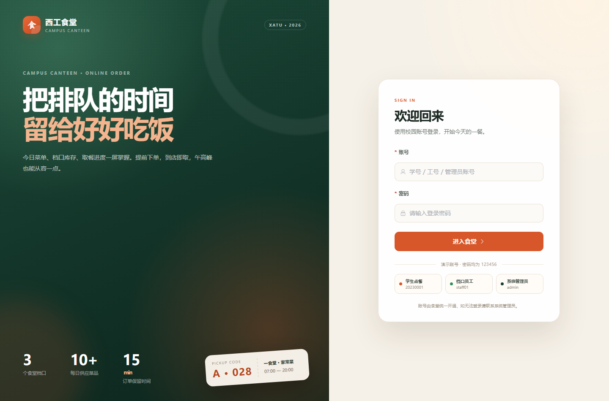
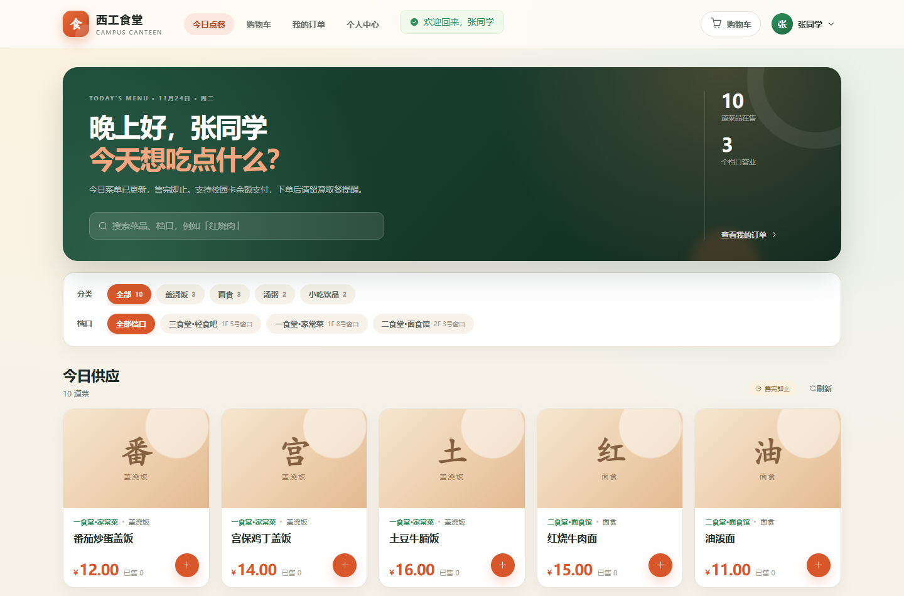
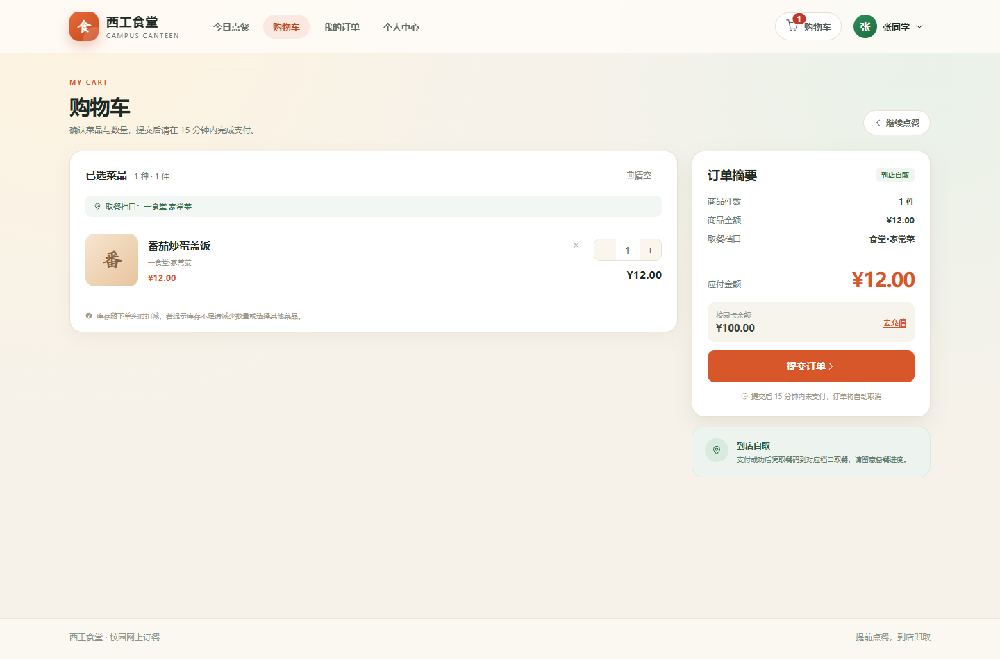
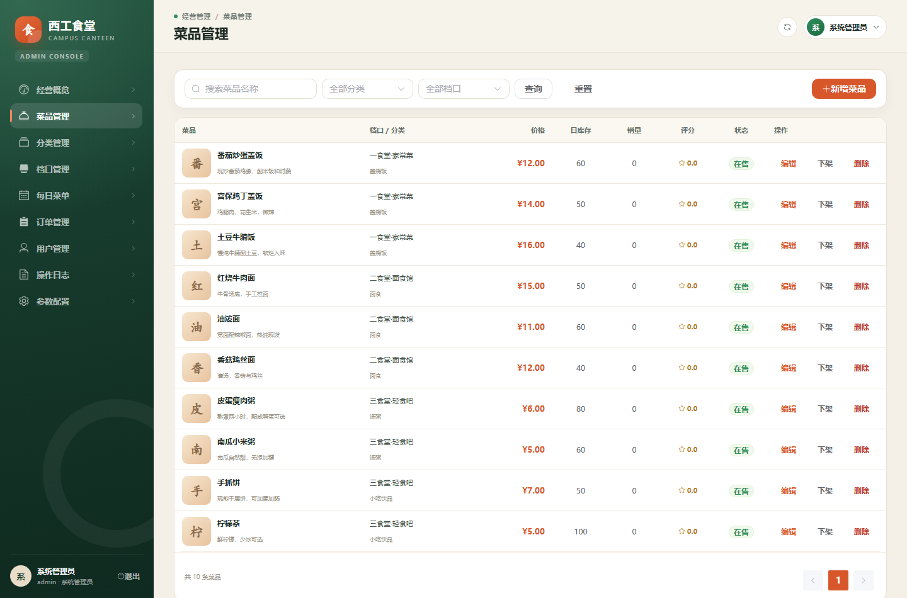
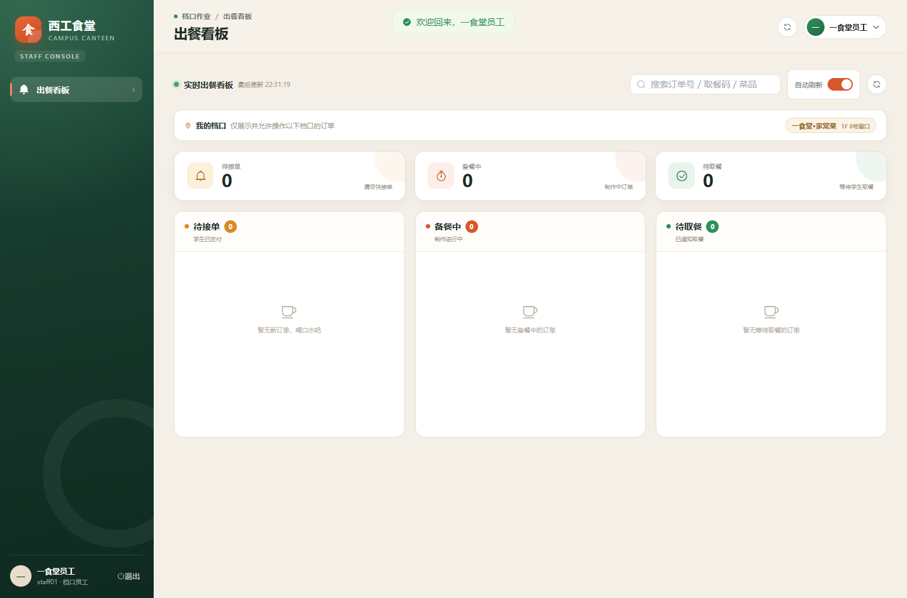
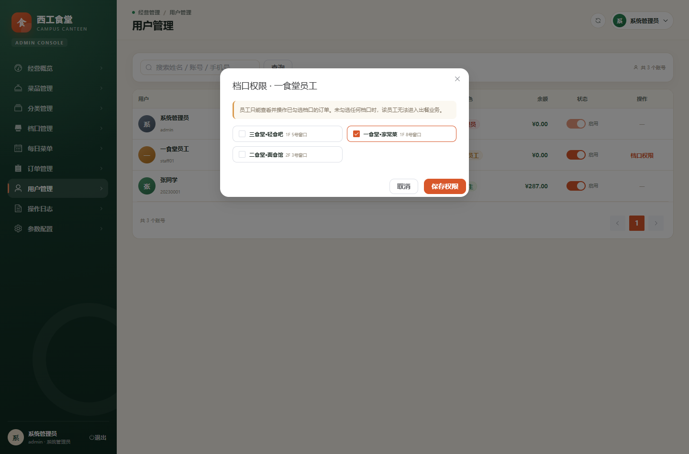

# canteen-order-ssm · 校园食堂网上订餐系统

一个前后端分离的校园食堂订餐系统，覆盖 **学生点餐 → 余额支付 → 档口接单/备餐/取餐 → 评价 → 经营管理** 全流程。

- 后端：`canteen-order/`，Spring Boot 2.7 + MyBatis-Plus + Spring Security + JWT + MySQL + Redis，端口 **8083**
- 前端：`canteen-order-web/`，Vue 3 + Vite + TypeScript + Element Plus + Pinia + ECharts，开发端口 **5173**
- 数据库：远程 MySQL 8.0 + Redis 7.0（通过 `application.yml` / 环境变量配置）

## 页面预览

### 登录页



### 学生端 · 今日点餐



### 购物车与结算



### 管理端 · 菜品管理



### 档口 · 出餐看板



### 管理端 · 员工档口权限



## 项目结构

```text
canteen-order-ssm/
├── canteen-order/               # Spring Boot 后端（8083）
│   ├── src/main/java/com/xatu/canteen/
│   │   ├── controller/          # 认证、用户、菜品、购物车、订单、支付、档口、管理端
│   │   ├── service/             # 业务服务（库存、订单、支付、统计、菜单、日志）
│   │   ├── mapper/              # MyBatis-Plus Mapper
│   │   ├── entity/ dto/ vo/     # 数据模型与出入参
│   │   ├── security/            # JWT、RBAC、认证过滤器
│   │   ├── config/              # Security、Redis、MyBatis、Swagger、WebMvc
│   │   └── common/              # 统一响应、异常、缓存键、AOP 日志
│   ├── src/main/resources/
│   │   ├── application.yml      # 8083、MySQL、Redis、JWT 配置
│   │   ├── db/migration/        # Flyway V1 建表、V2 种子数据、V3 员工档口绑定
│   ├── docs/                    # 技术栈与实施计划、OpenAPI
│   ├── README.md
│   └── target/canteen-order.jar
├── canteen-order-web/           # Vue 3 前端
│   ├── src/api/                 # Axios 与接口模块
│   ├── src/stores/              # auth / cart
│   ├── src/router/              # 路由 + 角色守卫
│   ├── src/layouts/             # 学生端 / 控制台布局
│   ├── src/views/               # 登录、学生、档口、管理端页面
│   ├── deploy/nginx.conf.example
│   └── README.md
└── docs/screenshots/            # 页面截图
```

## 快速启动

### 1. 后端

前置：JDK 11、Maven 3.9+，远程 MySQL/Redis 可连接。

```bash
cd canteen-order
mvn clean package -DskipTests
java -jar target/canteen-order.jar
```

启动后：

- 健康检查：`http://127.0.0.1:8083/actuator/health`
- Swagger UI：`http://127.0.0.1:8083/swagger-ui/index.html`
- OpenAPI：`http://127.0.0.1:8083/v3/api-docs`

Flyway 会自动执行 `db/migration`，首次启动创建 16 张表并写入演示数据；已有库按 V1 → V2 → V3 顺序增量迁移。

### 2. 前端

前置：Node.js 20+。

```bash
cd canteen-order-web
npm install
npm run dev
```

访问 `http://127.0.0.1:5173`。Vite 已将 `/api`、`/uploads` 代理到 `8083`，开发环境无需处理跨域。

生产构建：

```bash
npm run build
# 产物在 dist/，由 Nginx 托管，详见 canteen-order-web/README.md
```

## 演示账号

| 角色 | 账号 | 密码 | 默认入口 |
| --- | --- | --- | --- |
| 学生 | `20230001` | `123456` | `/menu` |
| 档口员工 | `staff01` | `123456` | `/staff/board` |
| 管理员 | `admin` | `123456` | `/admin/dashboard` |

学生初始余额 100 元；菜品 10 道、档口 3 个、分类 4 个，今日菜单随日期自动生成。

## 主要实现

### 后端

- **认证与权限**：Spring Security + JWT，access/refresh 双 token；`@PreAuthorize` 做角色控制；学生访问管理端返回 403，未登录返回 401。
- **数据权限**：`staff_stall` 维护员工与档口的有效绑定；`STAFF` 的订单列表、详情、接单/出餐/核销均按绑定档口强制过滤与归属校验，`ADMIN` 保留全量权限；管理员可在「用户管理 → 档口权限」为员工分配一个或多个档口。
- **统一响应与异常**：`Result<T>{code,message,data,traceId,timestamp}`；业务异常 HTTP 200 + `code != 200`；全局异常处理器；TraceId 贯穿日志。
- **缓存与库存**：Redis 缓存菜单/菜品/分类；下单 Lua 原子预扣库存，数据库兜底校验；取消/超时回补库存。
- **订单**：`requestId` 幂等；待支付订单 15 分钟超时取消；延迟队列 + 定时任务双保险；取餐码生成。
- **支付**：校园卡余额支付；余额扣减与订单状态在同一事务；支持退款回调。
- **管理端**：分类/档口/菜品 CRUD、图片上传、按日期发布菜单、库存调整、订单导出、用户启停、操作日志、参数配置。
- **可观测性**：AOP 操作日志、Actuator、Swagger、Flyway 版本化建表。

### 前端

- **登录与会话**：JWT 持久化；Axios 401 单飞 refresh 并重放原请求；刷新失败自动清理会话并跳登录。
- **角色路由**：学生 / 员工 / 管理员三套布局；路由守卫按角色拦截并回到各自首页。
- **学生端**：今日菜单筛选与搜索、加购、同档口校验、数量与库存联动、余额支付、取餐码倒计时、订单状态跟踪、评价、充值。
- **档口端**：顶部展示“我的档口”及楼层窗口；待接单 / 备餐中 / 待取餐三列看板只显示当前员工绑定档口的订单，接单 → 出餐完成 → 确认取餐，15 秒自动刷新。
- **管理端**：经营仪表盘（7/30 天趋势 + 热销排行）、菜品管理（含规格与图片上传）、分类/档口/菜单/订单/用户/日志/参数管理；用户管理支持为员工分配/收回多个档口。

## 企业级前后端分离部署

Nginx **只托管 `dist/` 构建产物，不存放源码**。源码在 Git 中，前后端可作为两个独立仓库，也可保持当前 monorepo 目录；CI 分别产出 `dist` 与 `jar`。

```text
浏览器
  │
  ▼
Nginx :80
  ├── /            → /var/www/canteen-order-web（Vue dist）
  ├── /assets/*    → 长缓存静态资源
  ├── /api/*       → 反向代理 Spring Boot 8083
  └── /uploads/*   → 反向代理 Spring Boot 8083
```

完整 Nginx 配置见 [`canteen-order-web/deploy/nginx.conf.example`](canteen-order-web/deploy/nginx.conf.example)。

> 安全提示：不要把数据库密码、JWT 密钥、服务器口令提交到 Git。部署时通过环境变量或服务器配置文件注入，且 MySQL/Redis 端口不要直接暴露公网。

## 已验证

- 后端：`mvn clean package -DskipTests` 成功；8083 启动、健康检查 UP；Flyway V1/V2/V3 成功；登录、菜单、购物车、订单、支付、档口、管理端接口已联调。
- 权限：`staff01` 仅能看到绑定档口 1 的订单，跨档口接单/详情返回 40206；清空绑定后订单列表为空且接单返回 20202；管理员全量可见，并可通过用户管理弹窗调整绑定。
- 前端：`npm run type-check`、`npm run build` 通过；`5173` + `8083` 实测登录、菜单、加购、购物车、确认订单、管理端列表、员工看板正常渲染；管理端 9 条路由巡检无接口错误与页面异常，390px 移动端布局可用。
- 管理端补充接口：`GET /api/v1/admin/categories`、`/admin/stalls`、`/admin/dishes`、`/admin/dishes/{id}` 已实现并验证返回 200。

## 文档

- 后端说明：[`canteen-order/README.md`](canteen-order/README.md)
- 技术栈与实施计划：[`canteen-order/docs/技术栈与实施计划.md`](canteen-order/docs/技术栈与实施计划.md)
- OpenAPI 快照：[`canteen-order/docs/openapi.json`](canteen-order/docs/openapi.json)
- 前端说明与部署：[`canteen-order-web/README.md`](canteen-order-web/README.md)
